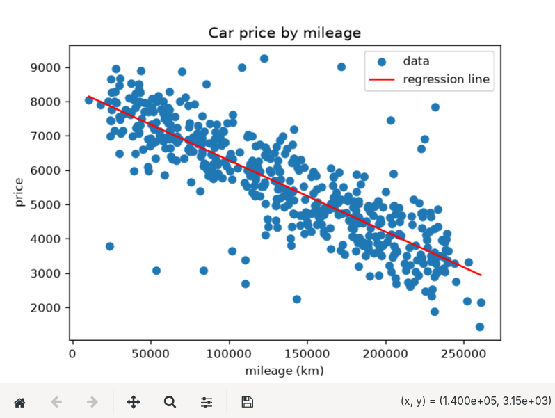

# ft_linear_regression

## Summary

- **[Project Description](#project-description)**
- **[Instructions](#instructions)**
- **[Usage](#usage)**
- **[Technical explanation](#technical-explanations)**
  - **[Notation](#notation)**
  - **[Linear Regression](#linear-regression)**
  - **[Gradient Descent Algorithm](#gradient-descent-algorithm)**
  - **[Evaluation Metrics](#evaluation-metrics)**
- **[Resources](#resources)**

## Project Description

**ft_linear_regression** is the first step in AI and Machine Learning from the 42 curriculum. The objective is to predict the price of car, depending on it's mileage, by using a linear function trained with a gradient descent algorithm. This project leads us to understand Machine Learing, linear function, descent gradient algorithm, and evaluations metrics (with the project bonus).

For this project, as I like to go beyond the original project, I also implent a Text User Interface (or more commonly a TUI). This simplifies the use of the algorithm, sparing the user from having to type in their commands manually. With this TUI, you can train the model, modify the training parameters (the dataset using by the model, the learning rate and the amount of iterations), predict a value and display a graph with a representation of regression line. In short, the entire project is accessible in few clicks, and improved.

## Instructions

### Requirements

To run this project there is some requirements (not too much):
- Linux (project developed on Ubuntu). macOS and other Unix-like systems should work; Windows is not supported, because the interactive menu relies on `termios`.
- Python 3.10 or later.
- `matplotlib` (the only third-party dependency, used to draw the graph).
- And for the TUI, an interactive terminal of at least 80x24 for the menu, and a graphical session if you want the graph window to open.

### Installation

```bash
git clone https://github.com/nico-ld/ft_linear_regression ft_linear_regression
cd ft_linear_regression

python3 -m venv .venv           # create the virtual environment
source .venv/bin/activate       # activate it (run this in every new terminal)
pip install -r requirements.txt # install matplotlib
```

If `python3 -m venv` fails on Ubuntu, install the module first:

```bash
sudo apt install python3-venv
```

Always run the commands below from the root of the project: the datasets and the trained parameters file (`thetas.json`) are looked up from the current directory.

## Running the project

Even if you don't use the TUI _(big error)_, you will found a Makefile at the root of the repository with everything you need :

Command | What it does
:------:|:------------
`make` | Starts the interactive menu (recommended way to use the project)
`make train` | Trains the model on dataset.csv (learning rate 0.25, 2000 iterations) and saves the result in `thetas.json`
`make predict` | Asks for a mileage and prints the estimated price.
`make evaluate` | Evaluates the trained model on the test split (RMSE, MAE and R²). Trains it first if no model exists
`make plot` | Shows the data points and the regression line
`make clean` | Removes the `__pycache__` folders **and** `thetas.json` (the trained model)

Without `make`, each target is a plain module call, for example `python3 -m srcs.main`.

## Usage 

### Interactive menu (`make`)


The header show the current dataset, the two parameters of the model, and wheter it **needs training** or is **trained**. The model is considered untrained while both paramters are `0.0`.

Use the **↑ / ↓** arrows to move (the current entry is highlighted) and **Enter** to confirm.

**Entry** | **Description**
------|------------
**Train** | Trains the model with the current settings, prints the final `theta0` and `theta1`, then the precision evaluation. The parameters are saved in `thetas.json`
**Train settings** | Changes the dataset, the learning rate and the number of iterations (see below)
**Predict** | Asks for a mileage (a number, 0 or more) and prints the estimated price. Unavailable until the model is trained
**Show graph** | Opens a window with the data points and the regression line. Unavailable until the model is trained
**Exit** | Quites the program. Ctrl+D and Ctrl+C quit as well

After an action, press any key to go back to the menu.

### Train settings

Select an entry, press **Enter**, then type the new value. An empty input keeps the current value. An invalid value is refused with a message and the previous value is kept.

**Settings** | **Default** | **Accepted values**
-------------|-------------|--------------------
Dataset | `dataset/dataset.csv` | An existing CSV file with the header `km,price` and at least 2 data rows.
Learning Rate | `0.25` | A number with 0 < value <= 1. But it is strongly advised to stay between `~0.12` and `0.5` (see below why).
Iterations | `2000` | A whole number from `1` to `1 000 000`.

> Notes:
> - Changing the dataset resets the model (`thetas.json` is overwritten with zeros): it has to be trained again on the new data.
> - The mileage is rescaled to the range [0, 1] before training, wich is why a learning rate above `1` could make the training diverge.
> - Too few iterations leave the model unconverged. With a learning rate of `0.25`, about `1000` iterations get withina  euro of the final values and `2000` fully converge on the provided datasets.

### Troubleshooting

**Symptom** | **Cause and fix**
------------|------------------
`Error: an interactive terminal is required` | The menu was started without a terminal (pipe, redirection, some IDE consoles). Run `make` in a normal terminal.
`ModuleNotFoundError: No module named 'matplotlib` | The virtual environment is not active. Run `source .vev/bin/activate`. Then `pip install -r requirements.txt`.
`No module named srcs` | The command was not run from the project root. `cd` into it, or use `make`.
`Model not trained: run `Train` first.` | `thetas.json` is missing or still zero (for example after `make clean` or a dataset change). Select **Train**.
The graph window does not open | No graphical session (SSH, container). Run the project in a desktop session.
The terminal looks broken after a crash (no echo, no cursor) | type `reset` and press Enter.
---

## Technical Explanations

> As this project may be complex if you never touch AI or if you're not friend with maths, this part explain every points you have to understand. To jump faster on wanted part here the [summary](#summary)

### Notation

Even if I tried to explain concepts in the simplest way, I can't remove math from the project. So here every notations I will use on the following parts:

Symbol | Meaning
-------|--------
$m$ | number of rows used for training
$n$ | number of rows used for an evaluation (the test split)
$x_i$ | mileage of the car $i$ (km)
$y_i$ | real price of the car $i$
$\hat{y}_i$ | price predicted by the model for the car $i$
$\theta_0,\ \theta_1$ | parameters of the model (intercept and slope)
$\alpha$ | learning rate
$\hat{x},\ \hat{y}$ | means of the mileages and of the prices

### Linear Regression

**Linear regression** is a fundamental supervised learning algorithm used to model the relationship between a dependent variable and one or more independent variables. It predicts continuous values by fitting a straight line that best represent the data. On **ft_linear_regression** : 
- The _mileage_ is the independent variable, that mean, we can control or observe it
- The _price_ is the dependent variable, it depends on the mileage.

> So basically, a linear regression algorithm uses the independent variable to predict the dependent one.

The objective of this algorithm is to get the **best-fit line**. This is the best straight line that represent the relationship between the independent variable (the input) and the dependent variable (the output). The goal is to minimize the difference between the actual data points and the predicted values generated by the model.



The model obtains this line with the **training**. For this, we will apply a [gradient descent algorithm](#gradient-descent-algorithm) on a given dataset, and repeat the operation the number of iterations we want. This will allow the model to obtain two parameters : **Theta 0** ($\theta_0$) and **Theta 1** ($\theta_1$). As I say, the objective is to get a straight line, so our two training parameters will define the linear function that represent the best-fit line : 
$$\hat{y} = \theta_0 + \theta_1 \cdot x$$

> As this function represent our linear regression, an AI model exist only with his training parameters (here thetas). The more complex an AI is, the more parameters it has. For example : Claude Fable 5.1 is estimated around 5 trillion parameters.

### Gradient Descent Algorithm

On a linear regression, we use gradient descent method to train our model. It is particularly useful for minimizing the cost or loss function.  
The Idea is to take repeated steps (scaled by the learning rate $\alpha$) in the opposite direction of the gradient (here $\theta_1$) of the function at the current point, because this is the direction of steepest descent. We can represent it by :

$$\theta_0 \leftarrow \theta_0 - \alpha \cdot \frac{1}{m} \sum_{i=1}^{m} \left( \hat{y}_i - y_i \right)$$

$$\theta_1 \leftarrow \theta_1 - \alpha \cdot \frac{1}{m} \sum_{i=1}^{m} \left( \hat{y}_i - y_i \right) x_i$$

Or more simply, this algorithm updates parameters in the direction of decreasing loss.

> Conversely, stepping in the direction of the gradient will lead to a trajectory that maximizes that function : a gradient ascent.

The update is **simultaneous**: both gradients are computed with the old values of $\theta_0$ and $\theta_1$ before either one is modified :

$$\mathrm{tmp}\theta_0 = \alpha \cdot \frac{1}{m} \sum_{i=1}^{m} \left( \hat{y}_i - y_i \right) \qquad \mathrm{tmp}\theta_1 = \alpha \cdot \frac{1}{m} \sum_{i=1}^{m} \left( \hat{y}_i - y_i \right) x_i$$

$$\theta_0 \leftarrow \theta_0 - \mathrm{tmp}\theta_0 \qquad \theta_1 \leftarrow \theta_1 - \mathrm{tmp}\theta_1$$

The parameters start at $\theta_0$ = $\theta_1$ = 0 and the update is repeated for the chosen number of iterations.

---

There are severals variants of gradient descent : 
- **Batch gradient descent**: Use the whole dataset to compute gradient of the loss function with respect to the parameters. In each iteration the algorithm calculates the average gradient for all the training examples and updates the model parametrs accordingly. More computationally expensive, but it has a more stable convergence.

- **Stochastic gradient descent (SGD)**: Update parameters using the gradient of the loss function with respect to a single training example at each iteration. That leads to a faster convergence, but it is less stable.

- **Mini-batch gradient descent**: It is a compromise between the two other variants. It updates the model parameters using a small, random subset of the training data called a mini-batch. This is a good balance between efficiency and stability.

> The _convergence_ refers to the process where the model finds the optimal parameters that minimize the loss function.


### Evaluation Metrics

To evaluates the precision of a regression model, we use some **regression metrics**. They quantify the prediction error of the model. Each of them emphasize different error characteristics. For example, some metrics penalize large errors more than small ones, while some others do the inverse. For this reason, metrics have to be choosen depending of the problem and the data nature.

For regression models, five metrics are used : **MSE, RMSE, MAE, R²** and **Ajusted R²**. But for this project I've only used **RMSE, MAE** and **R²**.

---

#### MSE and RMSE

$$\mathrm{MSE} = \frac{1}{n} \sum_{i=1}^{n} e_i^2 = \frac{1}{n} \sum_{i=1}^{n} \left( y_i - \hat{y}_i \right)^2$$

$$\mathrm{RMSE} = \sqrt{\mathrm{MSE}}$$

**Mean Squared Error (MSE)** and **Root Mean Squared Error(RMSE)** are useful for penalizing large errors, making them suitable when large prediction errors are costly.  
MSE is a common metric used to measure the **average of the squared differences** between predicted and actual values. It penalizes a large errors more severely, making it sensitive to outliers. As error are squared, the metric is not in the same unit as the target variable.  
RMSE is the square root of MSE, it solve the MSE problem (unit difference) by bringing the metric back to the same units as the target variable. It provide an easily interpretable measure of average error size.

The interpretations of these metrics is pretty simple : the more the value is closest to 0, better it is. But RMSE interpretation is straightforward, compared to MSE, since it's in the same units as the target variable.

---

#### MAE

$$\mathrm{MAE} = \frac{1}{n} \sum_{i=1}^{n} \left\lvert y_i - \hat{y}_i \right\rvert$$

**Mean Absolute Error (MAE)** metric measures the average magnitude of errors in predictions, without considering their direction. It's calculated as the average of absolute differences between predicted and actual values. As it provides a straightforward average error, it is more robust to outliers.

MAE interpretation is also simple, that metric gives a drect idea of the prediction error, in the same unit as the target variable. Lower values of MAE indicate a better fit

---

#### R² and Adjusted R²

$$R^2 = 1 - \frac{SS_{\mathrm{res}}}{SS_{\mathrm{tot}}} \qquad SS_{\mathrm{res}} = \sum_{i=1}^{n} \left( y_i - \hat{y}_i \right)^2 \qquad SS_{\mathrm{tot}} = \sum_{i=1}^{n} \left( y_i - \bar{y} \right)^2$$

$$R^2(Adj) = 1 - \frac{(1 - R^2)(n - 1)}{(n - p - 1)}$$

Where:
- $SS_{\mathrm{res}}$ = sum of squared residuals
- $SS_{\mathrm{tot}}$ = total sum of squares
- $p$ = the number of independent variables

**R-squared**, or the **coefficient of determination**, indicates the proportion of the variance in the dependent variable that is predictable from the independent variables. It's a measure of the model fit, and a good measure of how well the model explains variance but doesn't penalize for extra predictors.
**Adjusted R²** modifies R² to penalize adding irrelevant predictors to the model, making it more reliable for models with multiple predictors.

R² values closer to 1 indicate a better fit. A value of 1 means the model perfectly explains all the variance in the target variable.
Adjusted R² is prefered over R² for multiple regression as it penalizes unnecessary predictors, making it more reliable for evaluating.

## Resources 

- To understand **evaluations metrics** : [Medium article](https://farshadabdulazeez.medium.com/essential-regression-evaluation-metrics-mse-rmse-mae-r%C2%B2-and-adjusted-r%C2%B2-0600daa1c03a), [GeeksForGeeks article](https://www.geeksforgeeks.org/machine-learning/regression-metrics/)
- To understand **gradient descent** : [Wikipedia page](https://en.wikipedia.org/wiki/Gradient_descent)
- To understand **gradient descent variants** : [GeeksForGeeks article](https://www.geeksforgeeks.org/machine-learning/different-variants-of-gradient-descent/)
