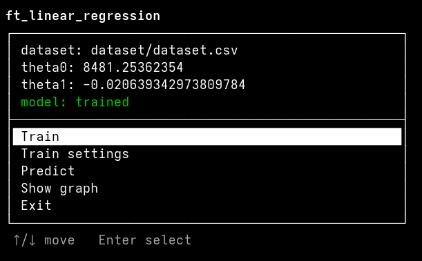

# ft_linear_regression

## Summary

- **[Project Description](#project-description)**
- **[Instructions](#instructions)**
- **[Usage](#running-the-project)**
- **[Technical explanation]()**
- **[Resources](#resources)**

## Project Description

**ft_linear_regression** is the first step in AI and Machine Learning from the 42 curriculum. The objective is to predict the price of car, depending on it's mileage, by using a linear function trained with a gradient descent algorithm. This project leads us to understand Machine Learing, linear function, descent gradient algorithm, and evaluations metrics (with the project bonus).

For this project, as I like to go beyond the original project, I also implent a Text User Interface (or more commonly a TUI). This simplifies the use of the algorithm, sparing the user from having to type in their commands manually. With this TUI, you can train the model, modify the training parameters (the dataset using by the model, the learning rate and the amount of iterations), predict a value and display a graph with a representation of regression line. In short, the entire project is accessible in few clicks, and improved.

## Instructions

### Requirements

To run this project there is some requirements (not too much):
- Linux (project developed on Ubuntu). macOS and other Unix-like systems should work; Windows is not supported, because the interactive menu relies on `termios`.
- Python 3.10 or later.
- `matplotlib` (the only third-party dependency, used to draw the graph).
- And for the TUI, an interactive terminal of at least 80x24 for the menu, and a graphical session if you want the graph window to open.

### Installation

```bash
git clone https://github.com/nico-ld/ft_linear_regression ft_linear_regression
cd ft_linear_regression

python3 -m venv .venv           # create the virtual environment
source .venv/bin/activate       # activate it (run this in every new terminal)
pip install -r requirements.txt # install matplotlib
```

If `python3 -m venv` fails on Ubuntu, install the module first:

```bash
sudo apt install python3-venv
```

Always run the commands below from the root of the project: the datasets and the trained parameters file (`thetas.json`) are looked up from the current directory.

## Running the project

Even if you don't use the TUI _(big error)_, you will found a Makefile at the root of the repository with everything you need :

Command | What it does
:------:|:------------
`make` | Starts the interactive menu (recommended way to use the project)
`make train` | Trains the model on dataset.csv (learning rate 0.25, 2000 iterations) and saves the result in `thetas.json`
`make predict` | Asks for a mileage and prints the estimated price.
`make evaluate` | Evaluates the trained model on the test split (RMSE, MAE and R²). Trains it first if no model exists
`make plot` | Shows the data points and the regression line
`make clean` | Removes the `__pycache__` folders **and** `thetas.json` (the trained model)

Without `make`, each target is a plain module call, for example `python3 -m srcs.main`.

## Usage 

### Interactive menu (`make`)



The header show the current dataset, the two parameters of the model, and wheter it **needs training** or is **trained**. The model is considered untrained while both paramters are `0.0`.

Use the **↑ / ↓** arrows to move (the current entry is highlighted) and **Enter** to confirm.

**Entry** | **Description**
------|------------
**Train** | Trains the model with the current settings, prints the final `theta0` and `theta1`, then the precision evaluation. The parameters are saved in `thetas.json`
**Train settings** | Changes the dataset, the learning rate and the number of iterations (see below)
**Predict** | Asks for a mileage (a number, 0 or more) and prints the estimated price. Unavailable until the model is trained
**Show graph** | Opens a window with the data points and the regression line. Unavailable until the model is trained
**Exit** | Quites the program. Ctrl+D and Ctrl+C quit as well

After an action, press any key to go back to the menu.

### Train settings

Select an entry, press **Enter**, then type the new value. An empty input keeps the current value. An invalid value is refused with a message and the previous value is kept.

**Settings** | **Default** | **Accepted values**
-------------|-------------|--------------------
Dataset | `dataset/dataset.csv` | An existing CSV file with the header `km,price` and at least 2 data rows.
Learning Rate | `0.25` | A number with 0 < value <= 1. But it is strongly advised to stay between `~0.12` and `0.5` (see below why).
Iterations | `2000` | A whole number from `1` to `1 000 000`.

> Notes:
> - Changing the dataset resets the model (`thetas.json` is overwritten with zeros): it has to be trained again on the new data.
> - The mileage is rescaled to the range [0, 1] before training, wich is why a learning rate above `1` could make the training diverge.
> - Too few iterations leave the model unconverged. With a learning rate of `0.25`, about `1000` iterations get withina  euro of the final values and `2000` fully converge on the provided datasets.

### Troubleshooting

**Symptom** | **Cause and fix**
------------|------------------
`Error: an interactive terminal is required` | The menu was started without a terminal (pipe, redirection, some IDE consoles). Run `make` in a normal terminal.
`ModuleNotFoundError: No module named 'matplotlib` | The virtual environment is not active. Run `source .vev/bin/activate`. Then `pip install -r requirements.txt`.
`No module named srcs` | The command was not run from the project root. `cd` into it, or use `make`.
`Model not trained: run `Train` first.` | `thetas.json` is missing or still zero (for example after `make clean` or a dataset change). Select **Train**.
The graph window does not open | No graphical session (SSH, container). Run the project in a desktop session.
The terminal looks broken after a crash (no echo, no cursor) | type `reset` and press Enter.

## Resources 

- To understand **evaluations metrics** : [Medium article](https://farshadabdulazeez.medium.com/essential-regression-evaluation-metrics-mse-rmse-mae-r%C2%B2-and-adjusted-r%C2%B2-0600daa1c03a)
- 
